# Campus Notification App

**Minggu 6: Authentication, Security & FCM** (Mobile Course, JTI Polinema)

Aplikasi Flutter untuk pengumuman kampus. Pengguna login (mock, siap diganti Firebase Auth), token disimpan aman, sesi diperbarui otomatis saat token kedaluwarsa, dan pengumuman masuk lewat Firebase Cloud Messaging (FCM) dengan deep link ke halaman `/pengumuman/:id`.

> **Identitas:** (isi nama, NIM, dan kelas)

---

## Daftar isi

1. [Tujuan](#tujuan)
2. [Fitur utama](#fitur-utama)
3. [Stack teknologi](#stack-teknologi)
4. [Struktur proyek](#struktur-proyek)
5. [Cara menjalankan](#cara-menjalankan)
6. [Praktikum 1: Autentikasi, secure storage, dan refresh token](#praktikum-1-autentikasi-secure-storage-dan-refresh-token)
7. [Praktikum 2: Setup FCM, permission, dan token lifecycle](#praktikum-2-setup-fcm-permission-dan-token-lifecycle)
8. [Praktikum 3: Tiga app state, deep link, dan topic](#praktikum-3-tiga-app-state-deep-link-dan-topic)
9. [Tugas utama (mini project)](#tugas-utama-mini-project)
10. [Prinsip keamanan yang diterapkan](#prinsip-keamanan-yang-diterapkan)
11. [AI Challenge](#ai-challenge)
12. [Refactoring Challenge](#refactoring-challenge)
13. [Testing](#testing)
14. [Hasil yang dicapai](#hasil-yang-dicapai)
15. [Refleksi](#refleksi)

---

## Tujuan

- Menerapkan alur autentikasi dengan **pola repository** yang bisa dipindah ke Firebase Auth hanya dengan mengganti sumber token.
- Menyimpan access token dan refresh token **hanya di secure storage** serta menerapkan refresh otomatis saat menerima `401`.
- Memahami arsitektur FCM (app server, Firebase, perangkat) dan mengelola **token lifecycle** (`getToken`, `onTokenRefresh`).
- Membedakan *notification payload* dan *data payload*, lalu membuktikan perilakunya di tiga app state: **foreground, background, terminated**.
- Menangani klik notifikasi dengan deep link GoRouter dan menggunakan **topic messaging** untuk broadcast.

## Fitur utama

- **Login mock + guard route.** Pengguna yang belum login selalu diarahkan ke `/login` dan kembali ke tujuan semula setelah login (parameter `from`).
- **Secure storage.** Access dan refresh token hanya di `flutter_secure_storage`, tidak di SharedPreferences dan tidak di log.
- **Refresh token otomatis (Dio).** `401` memicu refresh satu kali lalu request diulang. Refresh bersamaan dipakai bersama (*single-flight*). Jika refresh gagal, sesi dibersihkan dan pengguna kembali ke `/login`.
- **FCM.** Permission notifikasi, `getToken`, `onTokenRefresh` yang mengirim token ke `POST /devices`, dan langganan topik `pengumuman-kampus`.
- **Payload gabungan `notification + data`.** Klik notifikasi membuka `/pengumuman/:id` pada ketiga app state.
- **Validasi deep link.** `routeFromMessage` hanya menerima pola `/pengumuman/<id>`; payload lain dari luar dialihkan ke `/`.
- **Kartu Debug.** Menampilkan status izin, token terpotong (12 karakter pertama), status registrasi, dan log lifecycle tanpa token penuh.

## Stack teknologi

| Kebutuhan | Package |
|---|---|
| State management | `flutter_riverpod` ^3.4.3 |
| Navigasi / deep link | `go_router` ^18.0.2 |
| HTTP client | `dio` ^5.11.1 |
| Penyimpanan token | `flutter_secure_storage` ^11.2.0 |
| Firebase | `firebase_core` ^4.15.0, `firebase_messaging` ^16.7.0 |
| Banner foreground | `flutter_local_notifications` ^22.3.1 |

## Struktur proyek

```
js6/
├── lib/
│   ├── main.dart                     # init Firebase, GoRouter + redirect guard
│   ├── routes.dart                   # konstanta rute + routeFromMessage()
│   ├── firebase_options.dart
│   ├── data/
│   │   ├── token_store.dart          # satu-satunya pintu token (secure storage)
│   │   ├── auth_repository.dart      # login/refresh mock, titik ganti Firebase Auth
│   │   ├── api_client.dart           # Dio + interceptor refresh otomatis
│   │   ├── api_errors.dart           # DioException -> pesan ramah pengguna
│   │   └── mock_campus_adapter.dart  # backend simulasi (401, POST /devices)
│   ├── providers/
│   │   ├── auth_provider.dart        # AuthNotifier + provider data layer
│   │   └── push_provider.dart        # PushService provider
│   ├── messaging/
│   │   └── push_service.dart         # permission, token, 3 handler, topic
│   └── pages/
│       ├── login_page.dart
│       ├── home_page.dart            # kartu Debug FCM + demo keamanan sesi
│       └── announcement_page.dart    # tujuan deep link /pengumuman/:id
├── test/auth_push_test.dart
├── docs/ai-challenge.md
├── screenshots/
└── README.md
```

## Cara menjalankan

```bash
flutter pub get
flutter run            # gunakan emulator dengan Google Play atau perangkat Android fisik
flutter analyze
flutter test
```

**Prasyarat Android**

- `google-services.json` dari Firebase Console diletakkan di `android/app/`.
- Untuk Android 13+, tambahkan di `AndroidManifest.xml`:
  ```xml
  <uses-permission android:name="android.permission.POST_NOTIFICATIONS"/>
  ```
- Emulator tanpa Google Play Services tidak menghasilkan token (token `null`). Gunakan emulator ber-ikon Play Store atau perangkat fisik.

**Backend API.** Aplikasi memakai adapter simulasi di memori (`USE_MOCK_API=true` secara default). Ini bukan server kampus yang di-deploy. Endpoint yang dirancang adalah `POST /devices` dengan body `{ "fcm_token": "...", "platform": "android" }`. Untuk memakai backend sungguhan:

```bash
flutter run --dart-define=USE_MOCK_API=false --dart-define=CAMPUS_API_URL=https://api-kampus-anda
```

**Akun uji (mock).** Email apa pun yang mengandung `@` dan kata sandi minimal 6 karakter.

---

## Praktikum 1: Autentikasi, secure storage, dan refresh token

### Alur yang diimplementasikan

```
Login --> access + refresh disimpan di secure storage
Request API --Bearer access--> 401?
Ya  --> tukar refresh token --> access baru --> ulangi request SATU kali
Refresh gagal --> token dihapus --> kembali ke /login
```

Komponen kunci:

- `TokenStore`: seluruh token keluar-masuk hanya lewat kelas ini.
- `AuthRepository`: `login()` dan `refresh()` mock. Komentar di kode menandai titik pemasangan Firebase Auth.
- `buildApiClient`: interceptor Dio dengan flag `authRetried` agar tidak terjadi loop, plus *single-flight* refresh.
- `AuthNotifier` (Riverpod `AsyncNotifier<bool>`) dan redirect GoRouter dengan `refreshListenable` sehingga rute ikut berubah saat login/logout.

### Bukti

| Login | Validasi form | Refresh sukses (401 → refresh → retry 200) | Refresh gagal → kembali ke login |
|:---:|:---:|:---:|:---:|
|  | 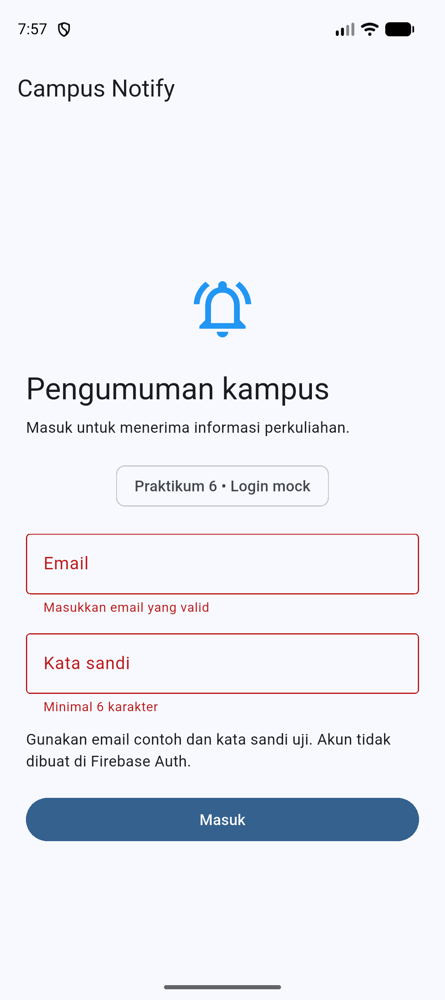 | 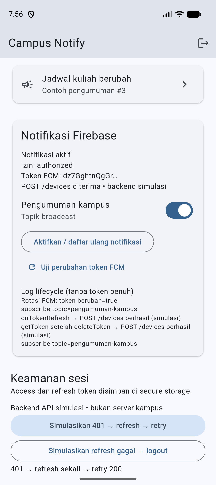 | 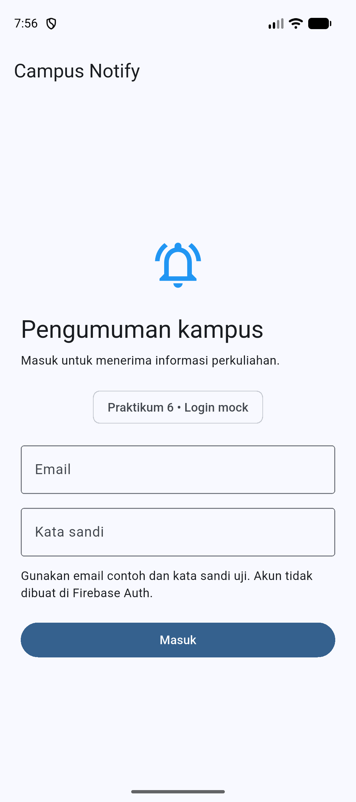 |

**Penjelasan.**

- *Validasi form:* email tanpa `@` menampilkan "Masukkan email yang valid" dan kata sandi pendek menampilkan "Minimal 6 karakter".
- *Refresh sukses:* tombol "Simulasikan 401 → refresh → retry" menghasilkan pesan `401 → refresh sekali → retry 200`, artinya request pertama ditolak, token diperbarui sekali, lalu request diulang dan berhasil.
- *Refresh gagal:* tombol "Simulasikan refresh gagal → logout" mengosongkan refresh token, refresh gagal, sesi dibersihkan, dan aplikasi kembali ke `/login`.

---

## Praktikum 2: Setup FCM, permission, dan token lifecycle

### Yang dilakukan

1. Membuat project Firebase `campus-notify-244107020049`, menambahkan aplikasi Android, dan memasang `google-services.json`.
2. Memanggil `Firebase.initializeApp` sebelum `runApp` (dibungkus try/catch agar login mock tetap jalan bila Firebase belum dikonfigurasi).
3. Meminta izin notifikasi runtime (Android 13+) lewat `FirebaseMessaging.requestPermission()`.
4. Mengambil token dengan `getToken()`, mengirimnya ke `POST /devices`, dan memantau perubahan lewat `onTokenRefresh`.
5. Membuktikan token lifecycle: tombol "Uji perubahan token FCM" (`deleteToken` + `getToken`) dan hapus data aplikasi.

### Bukti

| Dialog izin | Token awal | Setelah uji rotasi | Setelah hapus data | Login ulang |
|:---:|:---:|:---:|:---:|:---:|
| 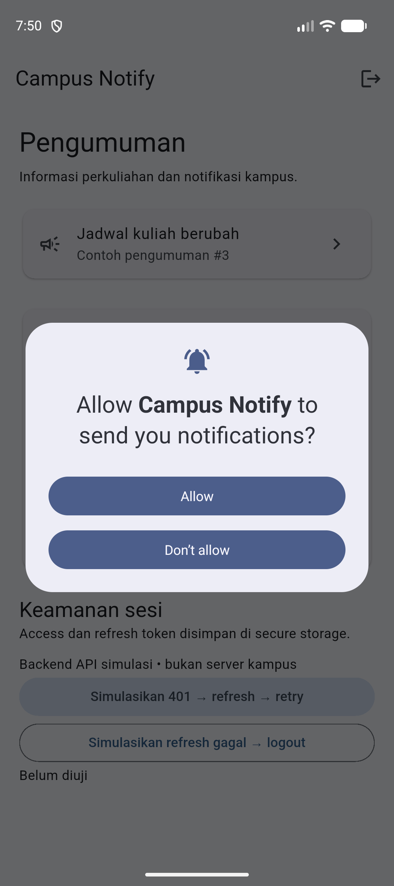 | 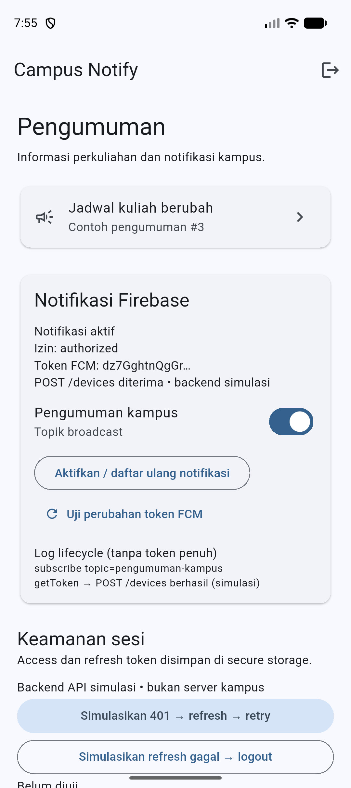 | 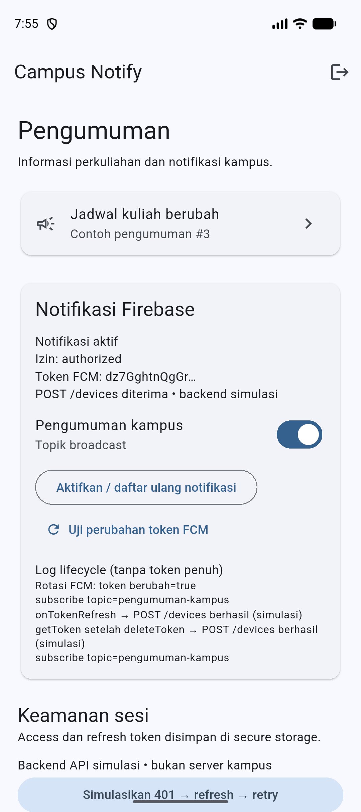 |  |  |

**Penjelasan.**

- Dialog izin muncul setelah login dan status berubah menjadi `Izin: authorized`.
- Token awal berawalan `dz7GghtnQgGr…`. Setelah **hapus data aplikasi**, token menjadi `d-Z-rWIhQje7…`, yaitu bukti token berubah dan pendaftarannya diulang ke `POST /devices`.
- Pada uji rotasi, log lifecycle menampilkan `Rotasi FCM: token berubah=true`, `getToken setelah deleteToken → POST /devices berhasil`, dan `onTokenRefresh → POST /devices berhasil`. Pada screenshot tersebut 12 karakter pertama token yang ditampilkan terlihat sama, sehingga bukti perubahan yang paling jelas adalah screenshot setelah hapus data dan baris log di atas.
- Token **tidak pernah ditampilkan penuh**; hanya 12 karakter pertama.

### Uji kirim pertama dari Firebase Console

Kampanye notifikasi percobaan "Jadwal kuliah berubah" dikirim ke aplikasi Android dengan status **Completed** (4 Okt 2026).

| Daftar kampanye di Firebase Console | Banner di perangkat (`fcm-console-test.png`) | Halaman tujuan setelah klik |
|:---:|:---:|:---:|
| 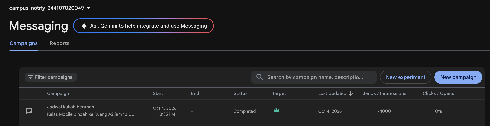 | 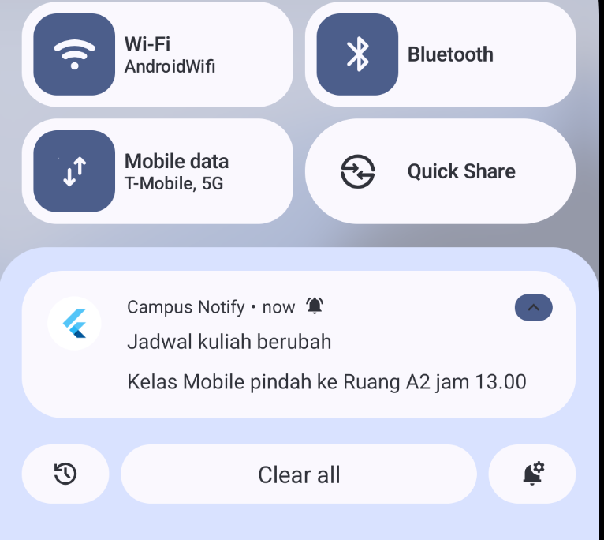 | 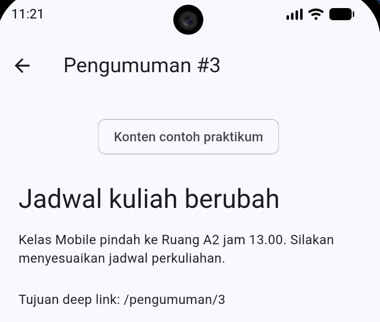 |

---

## Praktikum 3: Tiga app state, deep link, dan topic

### Payload uji

Dikirim dari Firebase Console ke topik `pengumuman-kampus`, memakai gabungan `notification + data`:

```json
{
  "message": {
    "topic": "pengumuman-kampus",
    "notification": {
      "title": "Jadwal kuliah berubah",
      "body": "Kelas Mobile pindah ke Ruang A2 jam 13.00"
    },
    "data": { "route": "/pengumuman/3", "id": "3" }
  }
}
```

### Handler yang dipakai

| State | Handler | Implementasi |
|---|---|---|
| Foreground | `FirebaseMessaging.onMessage` | Banner dibuat manual via `flutter_local_notifications`; `payload` berisi route untuk klik |
| Background | Banner sistem otomatis + `onMessageOpenedApp` | Klik → `routeFromMessage(message.data)` → `go()` |
| Terminated | `getInitialMessage()` + `getNotificationAppLaunchDetails()` | Dipanggil saat startup setelah router siap |
| Background isolate | `firebaseMessagingBackgroundHandler` | Fungsi top-level dengan `@pragma('vm:entry-point')`, tanpa BuildContext/Riverpod |

### Matriks pengujian

Perangkat: Android fisik. Payload sama untuk ketiga state.

| State | Yang diharapkan | Hasil | Bukti |
|---|---|---|---|
| **Foreground** | Banner lokal muncul, klik masuk `/pengumuman/3` | ✅ **Sesuai.** Banner muncul di atas halaman Beranda, log `foreground … route=/pengumuman/3`, klik membuka Pengumuman #3 | `praktikum3_foreground_state.png`, `praktikum3_foreground_banner.png`, `praktikum3_foreground_detail.png` |
| **Background** | Banner sistem muncul, klik masuk rute benar | ✅ **Sesuai.** Aplikasi di-minimize (layar Home), banner sistem muncul di panel notifikasi, klik membuka Pengumuman #3 | `praktikum3_background_state.png`, `praktikum3_background_banner.png`, `praktikum3_background_detail.png` |
| **Terminated** | Aplikasi terbuka ke rute benar via `getInitialMessage` | ✅ **Sesuai.** Aplikasi ditutup (Recents menampilkan "No recent items"), banner muncul, klik membuka aplikasi langsung ke Pengumuman #3 | `praktikum3_terminated_state.png`, `praktikum3_terminated_banner.png`, `praktikum3_terminated_detail.png` |

### Bukti per state

**Foreground**

| Aplikasi terbuka + banner lokal | Panel notifikasi | Hasil klik |
|:---:|:---:|:---:|
| 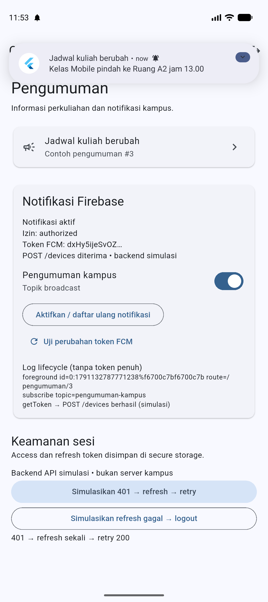 | 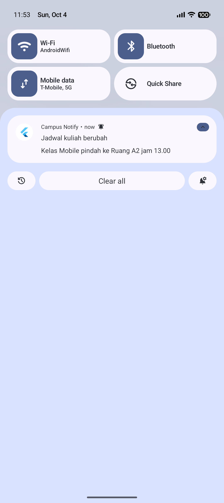 |  |

**Background**

| Aplikasi di-minimize | Banner sistem | Hasil klik |
|:---:|:---:|:---:|
| 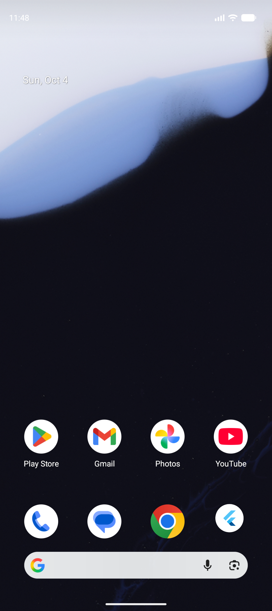 | 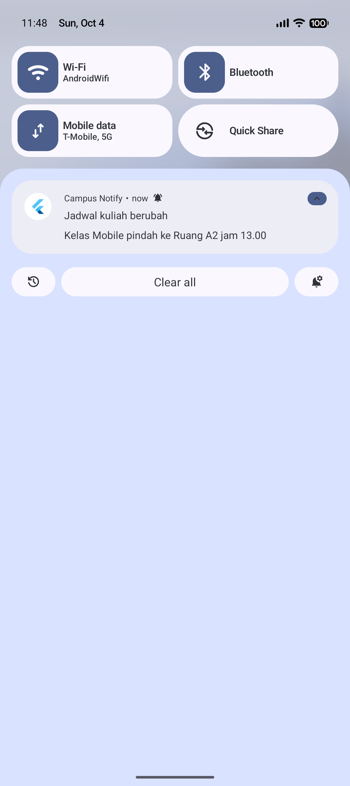 | 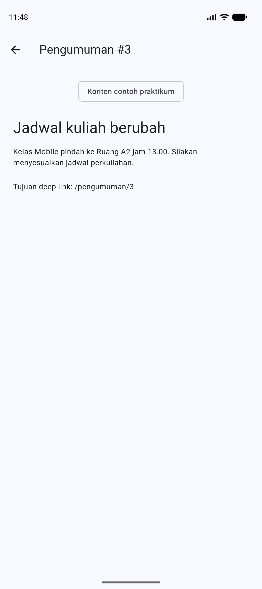 |

**Terminated**

| Aplikasi ditutup | Banner sistem | Hasil klik |
|:---:|:---:|:---:|
|  | 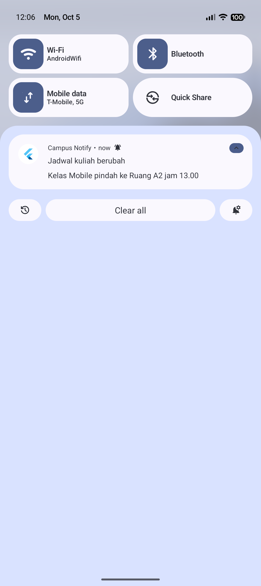 | 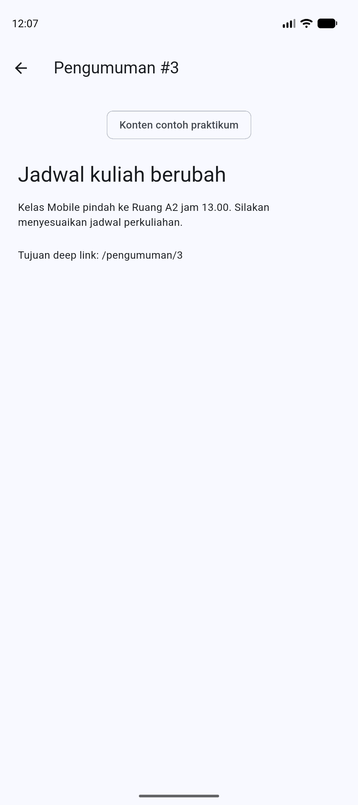 |

### Uji payload data-only (foreground)

Pesan **tanpa** blok `notification` hanya diteruskan ke handler. Log mencatat `foreground … route=/pengumuman/3` tetapi **tidak ada banner** yang muncul, karena `_foreground` sengaja berhenti bila `message.notification == null`. Ini membuktikan perbedaan notification payload vs data payload, dan menjadi alasan aplikasi ini selalu mengirim gabungan keduanya.

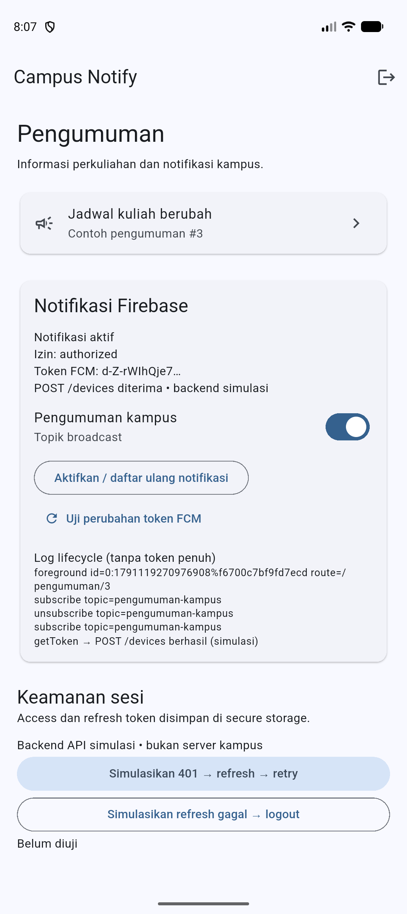

### Topic messaging

Saklar "Pengumuman kampus" memanggil `subscribeToTopic` / `unsubscribeFromTopic` pada topik `pengumuman-kampus`. Topik dipakai untuk **broadcast**; pesan personal (nilai, tagihan) seharusnya memakai token perangkat.

| Berlangganan | Berhenti berlangganan |
|:---:|:---:|
| 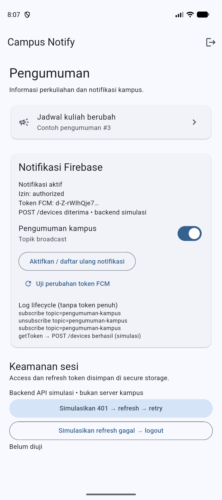 | 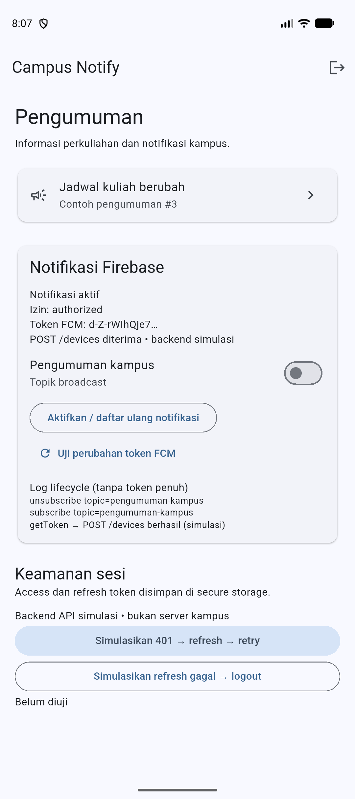 |

Log menampilkan `subscribe topic=pengumuman-kampus` dan `unsubscribe topic=pengumuman-kampus`. Saat logout, aplikasi otomatis berhenti berlangganan topik.

---

## Tugas utama (mini project)

Pemenuhan ketentuan mini project / industry challenge:

| # | Ketentuan | Status | Bukti |
|---|---|---|---|
| 1 | Login (mock) dengan guard route ke `/login` | ✅ | `main.dart` (redirect), `praktikum1_login.png` |
| 2 | Token di secure storage; Dio refresh sekali saat 401, logout bila refresh mati | ✅ | `api_client.dart`, `praktikum1_refresh_success.png`, `praktikum1_refresh_failed_login.png` |
| 3 | FCM: permission, `getToken` + `onTokenRefresh` ke `POST /devices`, subscribe `pengumuman-kampus` | ✅ (backend simulasi) | `push_service.dart`, `praktikum2_*`, `praktikum3_topic_*` |
| 4 | Notifikasi `notification + data`, klik buka `/pengumuman/:id` di tiga app state, tabel uji | ✅ | [Matriks pengujian](#matriks-pengujian) |
| 5 | Screenshot bukti (token terpotong, banner tiap state, halaman deep link) | ✅ | folder `screenshots/` |
| 6 | Minimal 2 test lulus | ✅ | [Testing](#testing) |
| 7 | AI Challenge didokumentasikan di `docs/` | ✅ sebagian | `docs/ai-challenge.md` |
| 8 | Struktur `lib/`, `test/`, `docs/`, `README.md`, `screenshots/` | ✅ | [Struktur proyek](#struktur-proyek) |

Halaman Beranda hasil akhir:

| Beranda (kartu Debug FCM) | Beranda (bagian bawah, hasil simulasi 401) |
|:---:|:---:|
| 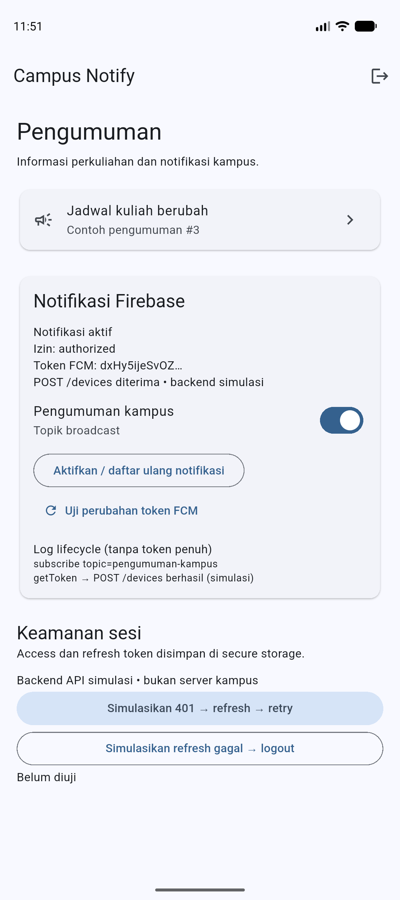 | 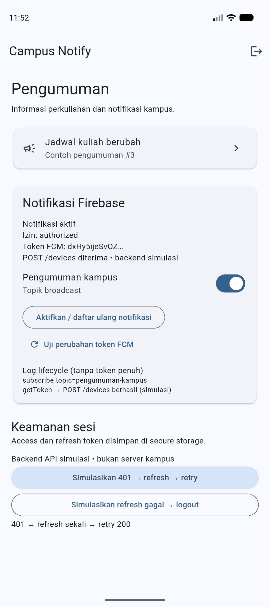 |

---

## Prinsip keamanan yang diterapkan

- Token **tidak** disimpan di SharedPreferences dan **tidak** di-hardcode di Dart. Semua lewat `TokenStore` → `flutter_secure_storage` (Keystore/Keychain).
- Token FCM tidak dicetak penuh ke log maupun UI; `maskedToken` hanya menampilkan 12 karakter pertama.
- Refresh token hanya dikirim lewat body request (bukan query URL).
- Mock backend tidak menyimpan token di log, respons, atau SharedPreferences.
- Deep link dari payload eksternal divalidasi dengan regex `^/pengumuman/[a-zA-Z0-9_-]+$`; selain itu dialihkan ke beranda.
- Background handler berjalan di isolate terpisah dan tidak menyentuh BuildContext, router, atau Riverpod.
- Screenshot laporan tidak menampilkan token penuh.

---

## AI Challenge

Dokumentasi lengkap ada di [`docs/ai-challenge.md`](docs/ai-challenge.md): prompt yang dipakai, checklist verifikasi, serta perbaikan manual beserta alasan teknisnya.

### Checklist verifikasi

| Pertanyaan | Temuan pada kode akhir |
|---|---|
| Background handler top-level + `@pragma('vm:entry-point')`? | Ya: `firebaseMessagingBackgroundHandler` di `push_service.dart`, tanpa BuildContext/Riverpod. |
| `onTokenRefresh` mengirim token baru ke backend? | Ya: listener memanggil `_registerToken` (`POST /devices`). Terbukti di log lifecycle. |
| Foreground memakai local notification manual? | Ya: `_foreground` memakai `_local.show`. |
| Klik di tiga state masuk rute benar? | Foreground: payload local notification. Background: `onMessageOpenedApp`. Terminated: `getInitialMessage` dan `getNotificationAppLaunchDetails`. Bukti di tabel pengujian. |
| Token/secret tidak di-hardcode dan tidak di-log penuh? | Token hanya di secure storage; tampilan hanya 12 karakter pertama. |

### Perbaikan manual terhadap draf AI

- `routeFromMessage` dibatasi ke `/pengumuman/<id>` agar payload luar tidak bisa membuka rute sembarang.
- Satu fungsi `routeFromMessage` di `routes.dart`; versi longgar yang duplikat dihapus.
- Refresh 401 dibagi satu `Future` (*single-flight*) dan diberi flag `authRetried` agar tidak loop.
- Redirect GoRouter memakai `refreshListenable` agar ikut berubah saat login/logout.
- Ikon notifikasi memakai `@mipmap/ic_launcher` agar tidak bergantung pada drawable tambahan.

---

## Refactoring Challenge

| Tugas | Hasil |
|---|---|
| Semua string rute dipindah ke satu file agar FCM dan GoRouter memakai konstanta yang sama | ✅ `lib/routes.dart` (`AppRoutes`) |
| Parsing `RemoteMessage → route` diekstrak ke fungsi murni agar bisa diunit-test tanpa Firebase | ✅ `routeFromMessage(Map<String, dynamic>)` |
| Pemetaan `DioException → pesan ramah pengguna` dipindah ke file tersendiri | ✅ `lib/data/api_errors.dart` (`apiErrorMessage`) |

---

## Testing

Firebase tidak diuji langsung; yang diuji adalah logika di sekitarnya (`test/auth_push_test.dart`):

| # | Test | Yang dibuktikan |
|---|---|---|
| 1 | `routeFromMessage` menangani route kosong dan tanpa slash | Fallback ke `/`, normalisasi slash, menolak URL luar |
| 2 | Data payload membawa id pengumuman | `data.id` selaras dengan rute `/pengumuman/3` |
| 3 | Provider auth membaca sesi tersimpan dan logout membersihkan token | Status login berasal dari token; logout menghapus keduanya |
| 4 | 401 refresh sekali dan retry; refresh gagal membersihkan sesi | 2 request (401 lalu 200); sesi dibersihkan dan `onSessionExpired` dipanggil |
| 5 | `apiErrorMessage` memetakan 401, offline, dan error lain | Pesan ramah pengguna |
| 6 | `AuthRepository` menolak kredensial dan refresh token tidak valid | `FormatException` pada input tidak valid |

```bash
flutter analyze   # No issues found!
flutter test      # All tests passed!
```

| `flutter analyze` | `flutter test` |
|:---:|:---:|
| 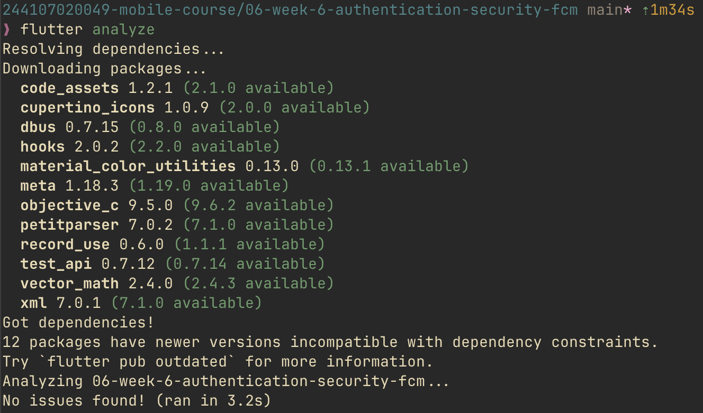 | 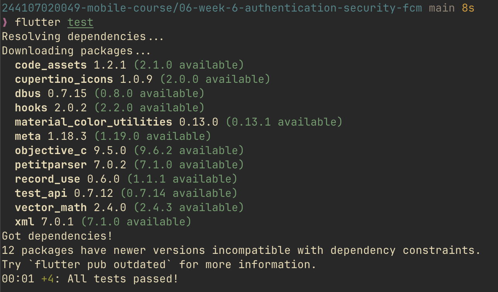 |

> **Catatan:** screenshot `flutter test` di atas diambil saat suite berisi 4 test (`+4`). File test saat ini berisi 6 test (test 5 dan 6 ditambahkan setelahnya). Jalankan ulang `flutter test` dan ganti screenshot agar sesuai dengan kode terbaru.

---

## Hasil yang dicapai

- Alur autentikasi lengkap dengan guard route, penyimpanan token aman, dan refresh otomatis satu kali yang terbukti lewat simulasi 401 sukses dan refresh gagal.
- Integrasi FCM berjalan di perangkat Android fisik: izin notifikasi, `getToken`, `onTokenRefresh`, dan topik `pengumuman-kampus`.
- Perubahan token terbukti (hapus data aplikasi menghasilkan token berbeda dan pendaftaran ulang ke `POST /devices`).
- Notifikasi gabungan `notification + data` terbukti membuka `/pengumuman/3` di **ketiga app state**; perbedaan dengan payload data-only terbukti di foreground.
- `flutter analyze` bersih tanpa temuan dan seluruh test lulus.
- Batasan yang diketahui: backend adalah adapter simulasi (bukan server kampus), login masih mock (belum Firebase Auth), dan pengujian dilakukan di Android (iOS belum diuji karena membutuhkan APNs).

## Refleksi

**Mengapa refresh token tidak boleh disimpan di SharedPreferences? Apa risikonya bila bocor?**
SharedPreferences tidak terenkripsi, sehingga dapat dibaca dari backup atau perangkat yang di-root. Refresh token berumur panjang, jadi bila bocor penyerang dapat terus menerbitkan access token baru dan menyamar sebagai pengguna tanpa perlu kata sandi sampai token dicabut di server.

**Apa yang rusak bila `onTokenRefresh` diabaikan selama satu semester?**
Backend menyimpan token basi. Token berubah saat reinstall, hapus data, atau rotasi keamanan (terbukti pada pengujian hapus data), sehingga pengumuman dikirim ke token yang sudah tidak valid dan mahasiswa berhenti menerima notifikasi tanpa ada error yang terlihat.

**Kapan memakai topik dan kapan token perangkat?**
Topik untuk broadcast ke banyak orang, misalnya "Jadwal kuliah berubah" untuk semua mahasiswa angkatan atau pengumuman satu UKM. Token perangkat untuk pesan personal, misalnya nilai, tagihan UKT, atau status pengajuan surat, karena isinya tidak boleh sampai ke pelanggan topik lain.

**Bagian mana dari draf AI yang ditolak atau diperbaiki, dan mengapa?**
Lihat [Perbaikan manual terhadap draf AI](#perbaikan-manual-terhadap-draf-ai). Perbaikan utamanya adalah validasi rute deep link (mencegah payload eksternal membuka rute sembarang) dan mekanisme *single-flight* + `authRetried` pada refresh token agar tidak terjadi refresh ganda atau loop 401.