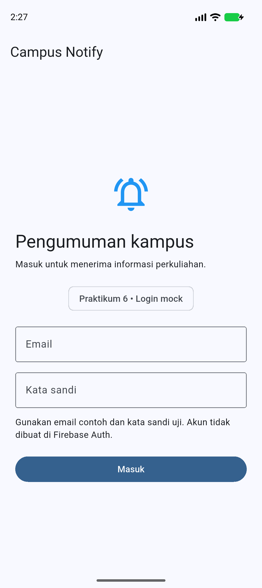
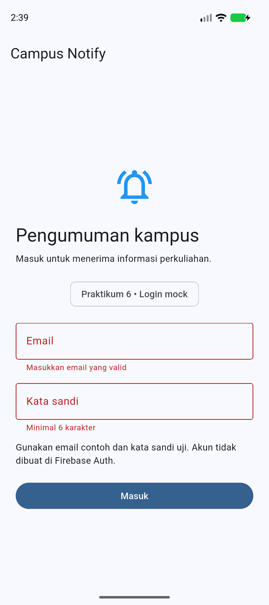
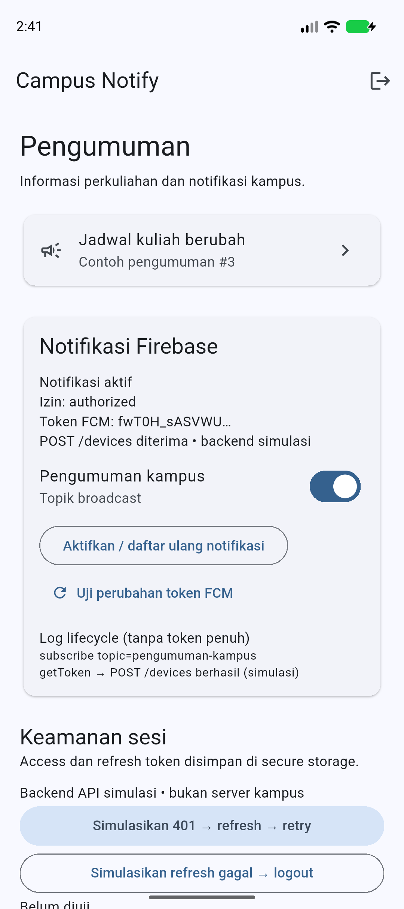
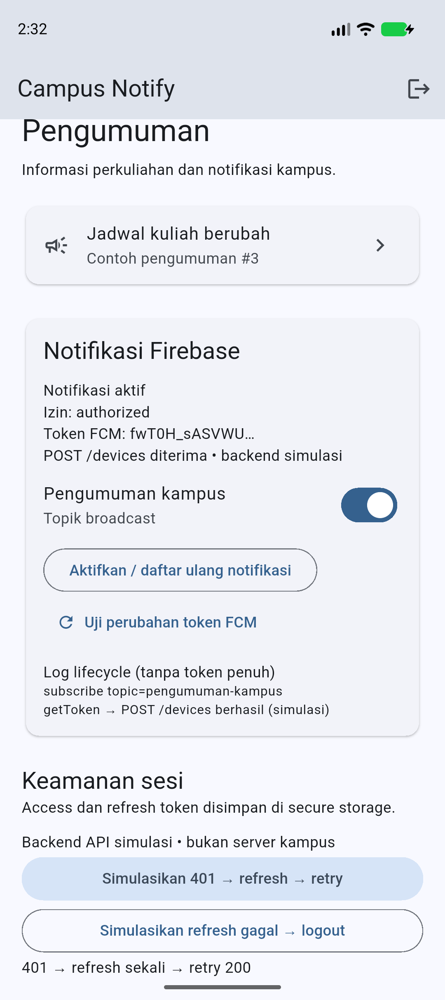
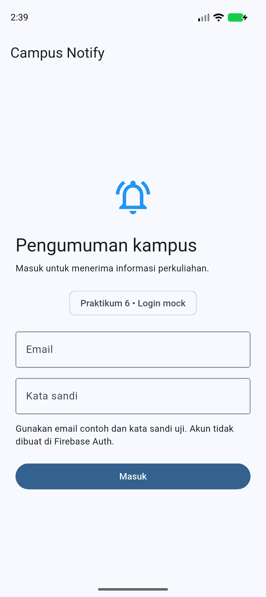
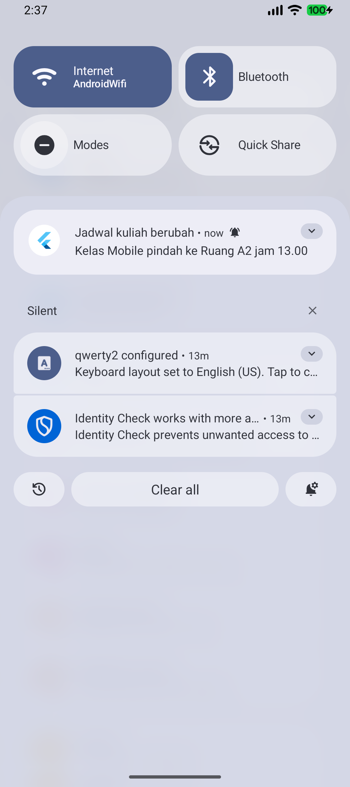
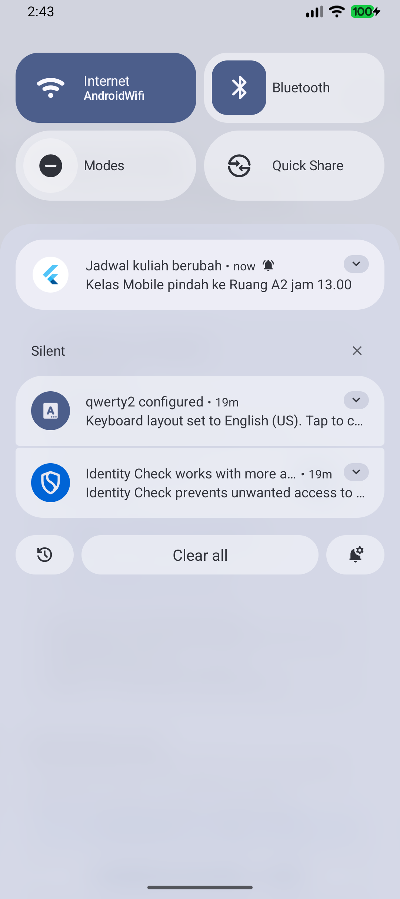
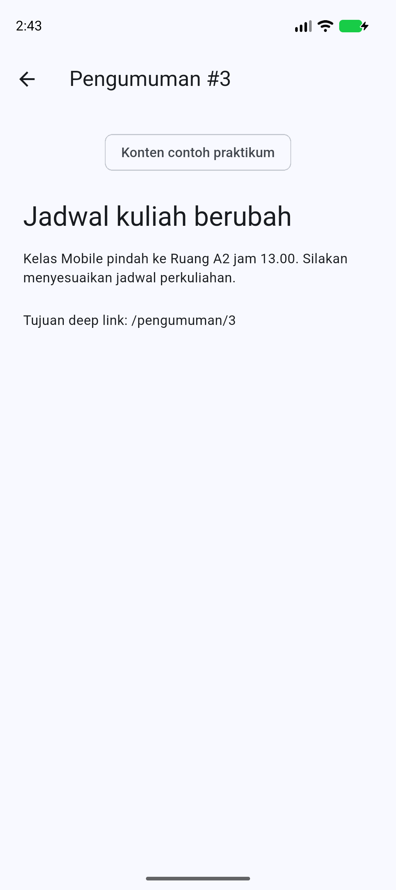
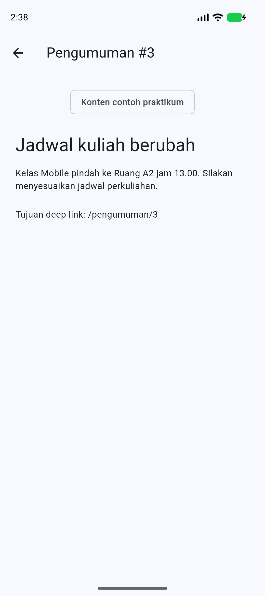
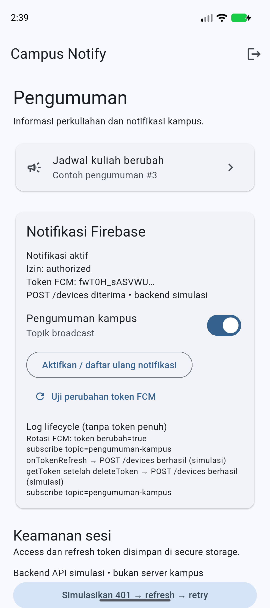

# Week 7 - Clean Architecture (Campus Notify)

Refactor aplikasi **Campus Notify** (auth + FCM + daftar pengumuman, lanjutan Minggu 6) menjadi **Clean Architecture feature-first**. Aplikasi dipertahankan **berjalan identik** sebelum dan sesudah refactor; yang berubah hanya struktur kode dan arah dependensinya. Bukti ada di bagian [Hasil: screenshot before / after](#hasil-screenshot-before--after).

## Daftar isi

1. [Tujuan pembelajaran](#tujuan-pembelajaran)
2. [Ringkasan materi](#ringkasan-materi)
3. [Fitur utama](#fitur-utama)
4. [Stack teknologi](#stack-teknologi)
5. [Diagram layer dan arah dependensi](#diagram-layer-dan-arah-dependensi)
6. [Struktur project](#struktur-project)
7. [Praktikum 1-2: peta file dan pelanggaran](#praktikum-1-2-peta-file-dan-pelanggaran)
8. [Bukti dependency rule (hasil grep)](#bukti-dependency-rule-hasil-grep)
9. [Hasil: screenshot before / after](#hasil-screenshot-before--after)
10. [Testing](#testing)
11. [AI Challenge dan verifikasi](#ai-challenge-dan-verifikasi)
12. [Refactoring Challenge](#refactoring-challenge)
13. [Cara menjalankan](#cara-menjalankan)
14. [Definisi selesai](#definisi-selesai)
15. [Refleksi](#refleksi)
16. [Referensi](#referensi)

---

## Tujuan pembelajaran

Setelah menyelesaikan codelab ini, mahasiswa mampu:

- menjelaskan prinsip SOLID dan separation of concerns dengan contoh kode Flutter;
- membedakan struktur feature-first vs layer-first beserta trade-off-nya;
- menjelaskan tiga layer (presentation, domain, data) dan aturan dependensi (dependensi mengarah ke dalam);
- membedakan entity vs model serta peran repository, use case, dan dependency injection;
- merefactor project Minggu 5/6 menjadi struktur feature-first yang terpisah layer-nya;
- menguji use case dengan repository palsu tanpa database atau jaringan sungguhan.

## Ringkasan materi

### SOLID dalam contoh Flutter

| Prinsip | Arti praktis | Gejala pelanggaran di Flutter |
| --- | --- | --- |
| **S**ingle Responsibility | Satu kelas punya satu alasan berubah | Widget 400 baris yang sekaligus fetch API, parsing JSON, dan formatting tanggal |
| **O**pen/Closed | Tambah perilaku lewat ekstensi, bukan edit kode lama | Setiap sumber data baru memaksa edit widget yang sudah jalan |
| **L**iskov Substitution | Pengganti harus bisa menggantikan aslinya tanpa merusak | Repository palsu untuk test melempar error yang tak pernah dilempar repository asli |
| **I**nterface Segregation | Jangan paksa klien bergantung pada yang tak dipakai | Satu interface raksasa `AppRepository` untuk auth + notes + push sekaligus |
| **D**ependency Inversion | Bergantung pada abstraksi, bukan concretion | Notifier memanggil `Dio` / `sqflite` langsung alih-alih repository |

### Tiga layer dan dependency rule

- **presentation**: widget, notifier/provider, router.
- **domain**: entity, repository interface, use case, failure. Murni Dart, tidak tahu Flutter, Dio, SQLite, atau Firebase.
- **data**: model, repository impl, Dio, SQLite, secure storage, FCM.

Aturan emas: **dependensi hanya mengarah ke dalam** (ke domain). Hasilnya, logika bisnis bisa di-unit-test murni.

### Feature-first vs layer-first

| Struktur | Bentuk | Kapan dipakai |
| --- | --- | --- |
| `feature-first` | `lib/features/<fitur>/{data,domain,presentation}` | Project multi-fitur (pilihan project ini): satu fitur bisa dipahami atau dihapus tanpa menyentuh fitur lain |
| `layer-first` | `lib/{data,domain,presentation}` global | Project kecil satu fitur; cepat tapi berantakan saat fitur bertambah |

### Kosakata peran

| Istilah | Peran | Lokasi |
| --- | --- | --- |
| Entity | Objek bisnis murni, tanpa `toMap/fromMap/toJson` | `domain` |
| Model | Representasi data luar (JSON/SQLite) + mapping ke entity | `data` |
| Repository interface | Kontrak yang dibutuhkan domain | `domain` |
| Repository impl | Cara memenuhi kontrak memakai Dio/SQLite/Firebase | `data` |
| Use case | Satu operasi bisnis (mis. `LoginUser`, `GetAnnouncements`) | `domain` |
| DI | Penyuntikan dependensi lewat provider Riverpod; widget tidak pernah membuat repository sendiri | `presentation` (wiring) |

> **Bukan sekadar pindah folder.** Memindahkan file tanpa memutus dependensi terlarang (widget -> Dio, notifier -> SQLite) bukan Clean Architecture. Yang dinilai adalah arah panah dependensi, bukan kedalaman folder.

## Fitur utama

- **Auth (login mock)**: validasi form, simpan access/refresh token di secure storage, session expired kembali ke login.
- **Refresh token**: 401 -> refresh sekali -> retry; refresh gagal -> logout.
- **Pengumuman**: daftar dan detail pengumuman (`/pengumuman/:id`).
- **Notifikasi FCM**: izin notifikasi, registrasi token ke backend simulasi (`POST /devices`), subscribe topik `pengumuman-kampus`, deep link ke detail pengumuman dari kondisi foreground, background, dan terminated, serta uji rotasi token.

## Stack teknologi

Flutter, Dart 3 (record dan sealed class), Riverpod, GoRouter, Dio, flutter_secure_storage, Firebase Auth/Cloud Messaging (sesuai Minggu 6), `flutter_test` untuk unit test.

## Diagram layer dan arah dependensi

```
presentation (widget, notifier, router)
      |
      v  bergantung ke
domain (entity, repository interface, use case, failure)
      ^
      |  diimplementasikan oleh
data (model, repository impl, Dio, secure storage, FCM)
```

Panah selalu menuju `domain`. `data` mengimplementasikan interface milik `domain`; `presentation` hanya memegang abstraksi lewat provider.

## Struktur project

Struktur target untuk fitur `auth` dan `announcements` (sesuaikan dengan nama file aktual di repository):

```
lib/
├── core/
│   ├── failures.dart        # Failure domain (murni Dart)
│   └── format.dart          # fungsi murni: format tanggal, parsing rute
├── features/
│   ├── auth/
│   │   ├── domain/   (entities, repositories/, usecases/)
│   │   ├── data/     (models/, repositories/ + secure storage)
│   │   └── presentation/ (providers/, pages/)
│   └── announcements/
│       ├── domain/   (entities, repositories/, usecases/)
│       ├── data/     (models/, repositories/ + Dio)
│       └── presentation/ (providers/, pages/)
└── routes.dart              # GoRouter + konstanta rute
test/                        # use case diuji dengan repository palsu
docs/                        # prompt AI, tabel usulan-vs-keputusan, hasil grep
screenshots/                 # bukti before/after
```

## Praktikum 1-2: peta file dan pelanggaran

Peta file lama ke layer (contoh dari codelab, lengkapi dengan file project Anda):

| File | Layer saat ini | Masalah | Tujuan baru |
| --- | --- | --- | --- |
| `pages/home_page.dart` | presentation | memanggil Dio langsung; format tanggal + parsing JSON di widget | pecah: widget tetap di presentation, logika ke use case + `core/format.dart` |
| `data/api_client.dart` | data | OK bila hanya dipakai repository, bukan widget | tetap di data |
| `providers/auth_provider.dart` | presentation (state) | OK bila hanya memanggil repository/use case | pindah ke `features/auth/presentation/providers/` |
| `data/auth_repository.dart` | data (+kontrak tercampur) | interface dan implementasi masih satu kelas | pecah: interface ke `domain/repositories`, impl ke `data/repositories` |

Tiga pelanggaran klasik yang dicari (target: nol hasil di presentation):

1. Widget yang menyentuh jaringan/database langsung.
2. Logika bisnis di dalam `build()` (`DateFormat`, `jsonDecode`, `toIso8601String`).
3. Instansiasi manual repository (DI bocor).

## Bukti dependency rule (hasil grep)

Jalankan dari root project, lalu tempel hasilnya. Semua harus menghasilkan **nol baris**.

```bash
# 1. Presentation steril dari data mentah
grep -rEn "Dio\(|openDatabase|getDatabasesPath|FlutterSecureStorage|SharedPreferences\.getInstance|jsonDecode" lib/features/*/presentation

# 2. Domain & core steril dari framework dan package
grep -rEn "import 'package:(flutter|dio|sqflite|firebase)" lib/features/*/domain lib/core

# 3. Tidak ada logika format/parsing di presentation
grep -rEn "DateFormat|jsonDecode|toIso8601String" lib/features/*/presentation

# 4. Tidak ada instansiasi repository manual
grep -rEn "Repository\(|Dio\(BaseOptions" lib/features/*/presentation
```

| Pemeriksaan | Hasil |
| --- | --- |
| 1. Presentation steril | `TODO: isi hasil (nol hasil / daftar temuan)` |
| 2. Domain & core steril | `TODO: isi hasil` |
| 3. Tanpa logika di build() | `TODO: isi hasil` |
| 4. Tanpa instansiasi manual | `TODO: isi hasil` |
| `flutter analyze` | `TODO: isi hasil` |
| `flutter test` | `TODO: isi jumlah test lulus` |

## Hasil: screenshot before / after

Setiap skenario diuji manual pada emulator Android. Kolom **Before** adalah project Minggu 6 sebelum refactor, kolom **After** adalah sesudah Clean Architecture. Tampilan dan perilaku sama, sedangkan struktur kodenya berbeda.

### 1. Login

<table>
  <tr>
    <th>Before</th>
    <th>After</th>
  </tr>
  <tr>
    <td></td>
    <td></td>
  </tr>
</table>

### 2. Validasi form login (after)

Email tidak valid memunculkan "Masukkan email yang valid" dan kata sandi pendek memunculkan "Minimal 6 karakter".



### 3. Beranda pengumuman dan panel notifikasi

<table>
  <tr>
    <th>Before</th>
    <th>After</th>
  </tr>
  <tr>
    <td></td>
    <td></td>
  </tr>
</table>

### 4. Detail pengumuman

<table>
  <tr>
    <th>Before</th>
    <th>After</th>
  </tr>
  <tr>
    <td></td>
    <td></td>
  </tr>
</table>

### 5. Refresh token (401 -> refresh sekali -> retry 200)

Tombol "Simulasikan 401 -> refresh -> retry" menghasilkan baris status `401 -> refresh sekali -> retry 200`.

<table>
  <tr>
    <th>Before</th>
    <th>After</th>
  </tr>
  <tr>
    <td></td>
    <td></td>
  </tr>
</table>

### 6. Sesi berakhir (refresh gagal -> logout -> login)

<table>
  <tr>
    <th>Before</th>
    <th>After</th>
  </tr>
  <tr>
    <td></td>
    <td></td>
  </tr>
</table>

### 7. Notifikasi push dan deep link (after)

Notifikasi "Jadwal kuliah berubah" membuka detail `/pengumuman/3` pada tiga kondisi aplikasi.

| Kondisi | Notifikasi | Hasil setelah diketuk |
| --- | --- | --- |
| Background |  |  |
| Foreground |  |  |
| Terminated |  |  |

### 8. Rotasi token FCM (after)

Tombol "Uji perubahan token FCM" mencatat log `Rotasi FCM: token berubah=true`, `onTokenRefresh -> POST /devices berhasil (simulasi)`, dan `getToken setelah deleteToken -> POST /devices berhasil (simulasi)`. Token ditampilkan terpotong (`fwT0H_sASVWU...`), tidak pernah penuh.



## Testing

Use case diuji murni dengan repository palsu, tanpa SQLite, Dio, atau Firebase. Contoh pola yang dipakai:

```dart
class FakeNoteRepository implements NoteRepository {
  FakeNoteRepository({this.items = const [], this.fail = false});
  final List<Note> items;
  final bool fail;

  @override
  Future<({List<Note> notes, Failure? failure})> fetchNotes() async {
    if (fail) {
      return (notes: const <Note>[], failure: const LocalFailure('db locked (simulasi)'));
    }
    return (notes: items, failure: null);
  }
  // ...
}

test('GetNotes meneruskan failure tanpa melempar', () async {
  final result = await GetNotes(FakeNoteRepository(fail: true)).call();
  expect(result.failure, isA<LocalFailure>());
  expect(result.notes, isEmpty);
});
```

Minimal dua test per use case: **sukses** dan **failure**. Widget test dapat mengganti repository lewat `ProviderScope(overrides: [...])`.

```bash
flutter analyze
flutter test
```

## AI Challenge dan verifikasi

Prompt yang digunakan:

```
Project Flutter saya: campus_notify (auth + FCM + daftar pengumuman).
Kondisi kini: folder lib/{data, providers, pages, messaging},
repository tercampur dengan implementasi, widget memanggil Dio langsung.
Tugas:
1. Usulkan struktur feature-first Clean Architecture
   (presentation/domain/data) untuk fitur auth + announcements.
2. Untuk tiap file lama, sebutkan tujuan barunya (pindah/pecah/hapus).
3. Tandai bagian yang over-engineering bila diterapkan ke CRUD sederhana,
   dan kapan use case benar-benar dibutuhkan vs repository langsung.
4. Tunjukkan wiring DI dengan Riverpod (tanpa package DI tambahan).
Jelaskan trade-off setiap keputusan.
```

Prompt, output awal AI, tabel usulan-vs-keputusan, dan hasil grep disimpan di folder `docs/`.

### Usulan AI vs keputusan final

| Topik | Usulan AI | Keputusan final | Alasan teknis |
| --- | --- | --- | --- |
| Use case per operasi | `TODO` | `TODO` | `TODO` |
| Lokasi interface repository | `TODO` | `TODO` | `TODO` |
| Package DI | `TODO` | `TODO` | `TODO` |
| Pemecahan fitur auth | `TODO` | `TODO` | `TODO` |

### AI Verification Checklist

- [ ] Interface repository tinggal di `domain`, implementasi di `data` (bukan satu folder).
- [ ] `domain` bebas import Flutter/Dio/SQLite/Firebase (diperiksa dengan grep).
- [ ] Tidak ada use case untuk tiap CRUD satu-baris (kalau ada, beri alasan tertulis).
- [ ] Entity bebas mapping (`toMap/fromMap/toJson` hanya di model).
- [ ] Wiring DI terpusat di provider; widget tidak `new Repository()` sendiri.
- [ ] Keputusan final dan alasan teknis dicatat (boleh berbeda dari saran AI).

## Refactoring Challenge

- [ ] Pola yang sama diterapkan ke fitur kedua (`auth` dan `announcements`): entity + repository interface + impl + minimal 1 use case + provider wiring.
- [ ] Formatting tanggal dan parsing rute diekstrak ke fungsi murni di `lib/core/format.dart`.
- [ ] Semua exception mentah diubah menjadi `Failure`; UI hanya menerima `message`.

## Cara menjalankan

```bash
flutter pub get
flutter run
flutter analyze
flutter test
```

Backend API dan pengiriman FCM bersifat **simulasi** (bukan server kampus). Jalankan di emulator/perangkat dengan Google Play services agar token FCM dapat diperoleh.

## Definisi selesai

- [ ] Aplikasi berjalan sama seperti sebelum refactor (uji manual 5 menit per fitur).
- [ ] Empat grep sterilitas menghasilkan nol hasil.
- [ ] `flutter analyze` bersih.
- [ ] Test hijau (minimal 2: use case sukses + failure dengan repository palsu).
- [ ] Screenshot before/after tersedia di `screenshots/` (lihat bagian hasil di atas).

## Refleksi

**1. Mengapa interface repository harus tinggal di domain, bukan di data? Apa yang rusak bila dibalik?**
Domain mendefinisikan *apa* yang dibutuhkan logika bisnis, sedangkan data hanya menjawab *bagaimana* memenuhinya. Bila interface ditaruh di data, domain harus meng-import data dan arah panah terbalik. Akibatnya perubahan Dio, SQLite, atau Firebase ikut memaksa perubahan logika bisnis, dan use case tidak bisa diuji tanpa membawa detail infrastruktur.

**2. Kapan use case benar-benar dibutuhkan, dan kapan repository langsung ke notifier sudah cukup?**
Use case dibutuhkan saat operasi menggabungkan lebih dari satu repository atau membawa aturan bisnis (validasi, pengurutan, sinkronisasi, alur refresh token lalu retry). Untuk CRUD satu-baris yang hanya meneruskan panggilan, repository langsung ke notifier sudah cukup. Use case menjadi wajib begitu logikanya tumbuh.

**3. Apa biaya over-engineering (use case per CRUD satu-baris) bagi tim kecil? Kapan biayanya sepadan?**
Biayanya berupa lebih banyak file dan boilerplate, navigasi kode yang lebih panjang, dan waktu onboarding yang lebih lama, padahal tidak ada logika yang dilindungi. Biaya itu sepadan saat tim membesar, fitur sering berubah, banyak sumber data (API, cache, lokal), atau logika bisnis cukup kompleks sehingga perlu diuji terpisah.

**4. Bagian mana dari usulan AI yang Anda tolak atau sederhanakan, dan mengapa?**
`TODO: isi dengan pengalaman Anda sendiri, mengacu pada tabel usulan-vs-keputusan di atas.`

## Referensi

- [Slide Week 7: Clean Architecture](https://jti-polinema.github.io/flutter-codelab/00-slides/Week_07_Clean_Architecture.html)
- [Flutter: App architecture guide](https://docs.flutter.dev/app-architecture/guide)
- [The Clean Architecture (Robert C. Martin)](https://blog.cleancoder.com/uncle-bob/2012/08/13/the-clean-architecture.html)
- [Riverpod: Providers & dependency injection](https://riverpod.dev/docs/concepts/providers)
- [Dart: Records](https://dart.dev/language/records)
- [fpdart package (alternatif Either)](https://pub.dev/packages/fpdart)
- [GoRouter](https://pub.dev/packages/go_router)